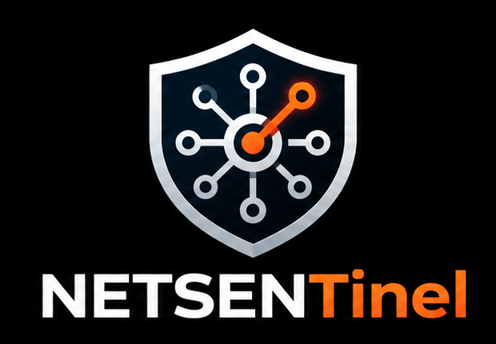

<div align="center">
  
</div>
# NETSENTINEL

### Network Monitoring & Security Investigation

A Python-based desktop application for network traffic analysis, threat intelligence correlation, and cybersecurity investigations on Ubuntu Linux.

**Monitor · Analyze · Investigate · Document**

</div>

---

## Overview

NETSENTINEL is a native desktop application designed to bring essential network monitoring and investigation capabilities into one workspace.

Built with Python, Tkinter, Scapy, Nmap, and JSON-based local storage, it provides a practical environment for cybersecurity learning, network analysis, and investigation workflows.

## Features

- **Packet Inspector:** Inspect captured packets and search using supported filters.
- **Live Packet Capture:** Monitor traffic visible to the selected network interface.
- **TCP Analysis:** Review TCP flows and best-effort stream information.
- **DNS Analysis:** Examine observed DNS activity and protocol statistics.
- **Network Discovery:** Discover hosts on networks you are authorized to assess.
- **Alert Center:** Review heuristic alerts, add investigation notes, and track status.
- **PCAP Lab:** Analyze saved packet captures and export investigation reports.
- **Threat Intelligence:** Manage local IP and domain indicators and correlate them with captured traffic.
- **Case Management:** Organize investigation notes, findings, and evidence.
- **Security Log Import:** Import supported Suricata EVE JSON and Zeek TSV files for offline review.
- **Investigation Reports:** Export supported findings in HTML and JSON formats.
- **Built-in Help:** Access usage instructions, supported filters, and troubleshooting guidance.

## Installation

**Requirements:** Ubuntu Linux, Python 3, and the required system dependencies.

Clone the repository:

```bash
git clone https://github.com/yatshivasai/NetseNtiNel.git
cd NetseNtiNel
```

Install dependencies and launch:

```bash
chmod +x setup.sh run.sh
./setup.sh
./run.sh
```

## Quick Start

1. Launch NETSENTINEL.
2. Select a network interface you are authorized to monitor.
3. Start packet capture or load a saved PCAP file.
4. Inspect packets, DNS activity, TCP flows, and available alerts.
5. Add threat indicators when needed and correlate them with a capture.
6. Document findings and export an investigation report.

For detailed instructions, supported search expressions, and troubleshooting, consult [`HELP.md`](HELP.md).

## Testing

Run the automated tests from the project directory:

```bash
python3 -m unittest discover -s tests -v
```

Automated tests do not replace end-to-end testing with real network interfaces and representative capture files.

## Security and Limitations

- Only monitor or scan networks you own or have explicit permission to assess.
- Packet capture only exposes traffic visible to the selected interface or capture source.
- HTTPS application data generally remains encrypted.
- TCP stream reconstruction may be incomplete when packets are missing.
- Heuristic alerts and threat indicator matches require analyst verification.
- Imported Suricata and Zeek logs are analyzed offline; their services are not automatically deployed.
- Evidence hashes help verify file integrity but do not independently establish provenance.
- NETSENTINEL is an actively developed project and is not a certified enterprise SIEM.

## Documentation

- [User Guide](HELP.md)
- [Security Policy](SECURITY.md)
- [Contributing Guidelines](CONTRIBUTING.md)
- [Publishing Guide](PUBLISH_TO_GITHUB.md)

## License

NETSENTINEL is released under the MIT License. See [`LICENSE`](LICENSE).

---

<div align="center">

**NETSENTINEL — Monitor. Analyze. Investigate.**

</div>
